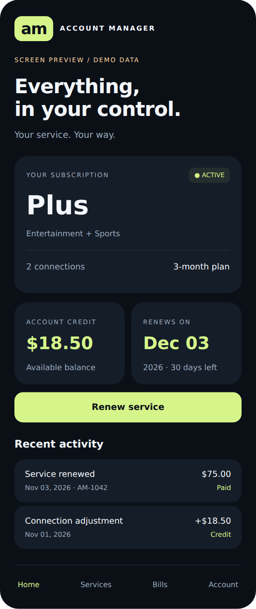
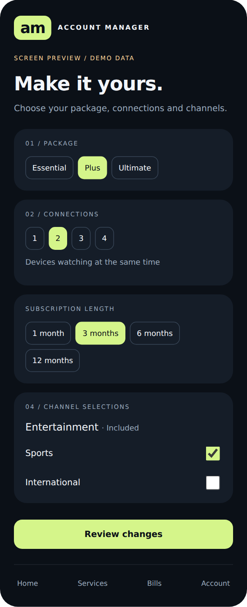
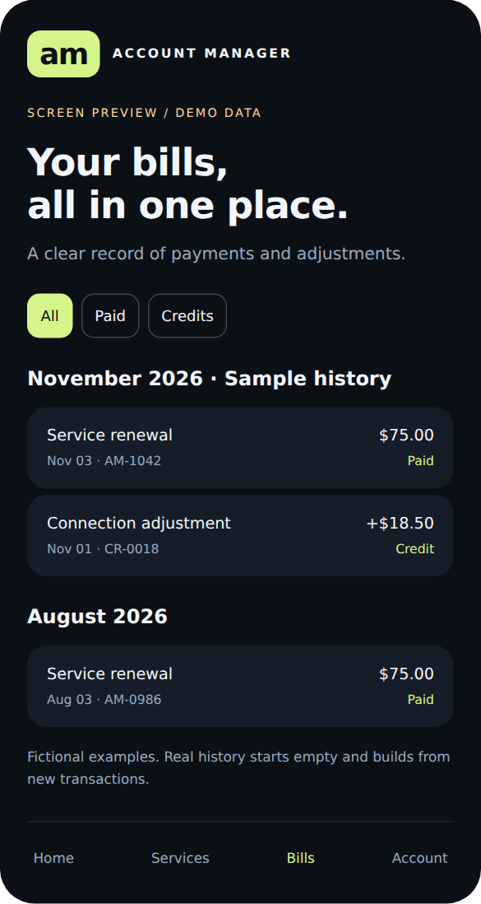

# AM App

Universal Android customer account-management app for participating resellers and their customers.

## Source of truth

[derangedchief-crypto/AM-App](https://github.com/derangedchief-crypto/AM-App), branch `main`, is the canonical source for this project and its confirmed requirements.

## Confirmed scope

- Sign in with the Hub-style activation code or existing service username and password.
- View services, expiry dates, and past bills.
- Build bill history from new app transactions in a database the owner will provide; no historical bill import is needed.
- Renew active or expired services using AM-owned billing functions based on the existing ARVIO flow.
- Customers can add/remove permitted bouquets for free and renew their current package with its existing connection count. Package, connection and term changes require contacting their reseller.
- Self-service modifications, downgrade credits and proration are outside the current release scope.
- One universal customer app for any participating reseller, rather than a separate APK per reseller.
- A new **AM App** section in the reseller panel lets each reseller enable customer access and configure their own billing/renewal flow. The earlier owner-only audience is superseded.
- Determine the customer's owning reseller from verified server-side line ownership, and scope service access, invoices, credit, and checkout to that reseller. Never let Android choose a trusted reseller identity or merchant.
- Signed APK releases and in-app updates following Extreme Hub's release process.
- Publish source code in the public AM-App GitHub repository, as requested by the owner.
- Keep AM's implementation independent. Hub is a reference only: do not modify its app, backend functions, enrollment, settings, or deployment for this project.
- Show services as package → bouquets, without categories. Resellers control whether customers may edit permitted bouquets.
- Remember the customer's original login securely across app restarts; explicit sign-out removes it.
- Each reseller sets its own customer renewal price for every offered package. The worker's fixed package credit cost is still deducted from that reseller on renewal; retail money prices never overwrite wholesale credits. Bouquet selections carry no extra charge.

## Reseller panel and worker reference

Use the owner's `derangedchief-crypto/Reseller-website` as the reference for package, bouquet, renewal, and connection-management functions. AM owns its copies/implementations; the reseller site and existing workers remain separate. See [`docs/reseller-worker-reference.md`](docs/reseller-worker-reference.md) for traced endpoints, known schema, and remaining deployment inputs. The live APK shows a bouquet setup-pending state until this backend is connected; category mapping is no longer needed.

The hidden reseller management page at `/am-app/` is installed and saving preferences. Square sandbox setup and signed webhooks were verified on the user's host. Version 0.3.0 connects Android to AM's customer API for ownership-checked login, current package/bouquets, reseller renewal prices, Square checkout, renewal status and billing history. **Deploy the worker add-on and website update before installing the connected APK.** See [`docs/connected-renewal-deployment.md`](docs/connected-renewal-deployment.md). Live customer payment/fulfilment still requires host acceptance; local tests use synthetic payments.

## Billing reference for future integration

Reference: `derangedchief-crypto/ARVIO`, branch `main`.

- Android: `app/src/main/kotlin/com/arflix/tv/management/RenewalLoginClient.kt` and `RenewalCheckoutRepository.kt`.
- Backend: `control-center/src/RenewalPayments.php`, `RenewalSettings.php`, `CardGateway.php`, and `RenewalWorker.php`.
- Hosted checkout: `control-center/public/renew.html`.
- Release process: `.github/workflows/publish-release.yml`.

The existing renewal login uses a signed device challenge and service credentials (or an activation code) to issue a short-lived checkout capability. Country selection controls eligible gateways: Stripe/Square in Canada and Stripe/Square/Rampex in the USA, subject to provider configuration.

Current checkout requires an approved branded package and an expired service. A separate account-management package needs explicit backend registration and customer-scoped sessions. Its credentials must not be treated as admin credentials, and a checkout token is not a general account session.

## Required integration work

1. Build AM-owned customer-session and service/invoice endpoints, referencing the existing Hub functions without changing Hub. Direct provider login is now implemented for read-only service details.
2. Record new invoices and verified payment/fulfilment status server-side in the owner's billing database. History starts empty; opening the app is not evidence of payment. Confirm the database connection and schema before integration.
3. Implement early renewal in AM's own billing/fulfilment functions, preserving remaining service time and exactly-once fulfilment. Do not change Hub's eligibility rules or worker deployment.
4. Build the Android account, services, bills, renewal, and settings screens against those endpoints.
5. Configure a separate signing key and publish signed APK updates through public GitHub Releases. Keep signing keys, database credentials, payment secrets, and customer data outside the repository; no GitHub access token belongs in the APK.
6. Enforce renewal-only customer checkout regardless of legacy reseller change permissions. Direct service-change requests to the customer's reseller; no customer proration or downgrade-credit ledger is required for this release.

## Status

Version **0.3.1: bouquet editing and connected renewals**. Services now offers bouquet checkboxes and a free confirmed save, controlled by the reseller's bouquet permission. Matching uppercase AM artwork appears in the launcher and app. Package/connection changes still require the reseller. The app uses AM customer APIs with authoritative ownership checks; there is no direct-provider fallback for account access.

[Download the 0.3.1 APK](https://github.com/derangedchief-crypto/AM-App/releases/download/v0.3.1-bouquets-renewals/AM-Account-0.3.1-bouquets-renewals-test.apk). Update both worker and website first, then enable **Add or remove permitted bouquets (free)** in AM customer permissions. Application ID/signing remain compatible with earlier test builds.

Login, bouquet/package reads, renewal offers, confirmation, Square browser checkout, status recovery and new order history are connected in code. Production mode requires server-verified captured payment before fulfilment; sandbox never renews. Service changes are reseller-only. Downloads/updates open GitHub Releases; silent/automatic APK installation is not implemented. Live device and production-payment acceptance remain deployment checks.

### Screens

- Activation-code or service-credential sign-in with loading and error states
- Home dashboard with verified service status, expiry, and connection counts
- Real worker package and assigned bouquets; no categories
- Explicit unavailable states for package/duration fields the provider doesn't supply
- Current-package renewal confirmation, secure Square checkout and payment/renewal status
- New order history with sandbox labels and recoverable original orders
- Account refresh, stale-data notice, and independent sign-out
- Automatic verification of an encrypted saved login on restart, retry without retyping after an outage, and removal on explicit sign-out

The original service-change designs remain in the historical visual companion. Current customer controls are renewal-only; package changes are reseller-managed.

### Build and run

Requires JDK 17 and Android SDK 36. Set `ANDROID_HOME` or create an ignored `local.properties` with `sdk.dir`.

```sh
./gradlew :app:testDebugUnitTest :app:assembleDebug :app:lintDebug
adb install -r app/build/outputs/apk/debug/app-debug.apk
```

Open **AM Account** after deployment and reseller opt-in, using an approved customer's Hub activation code or service username/password. The app uses application ID `net.extremeiptv.account`; the original `.demo` APK can coexist. After successful verification, the original login is encrypted with AES-256-GCM and an app-specific Android Keystore key in app-private, no-backup storage. A code login saves the code, not the password returned by code resolution. AM bearer tokens stay in memory. Raw secrets are not logged or saved in UI state/backups.

On restart the app verifies the saved login before showing account data. A temporary outage preserves it and offers retry. Sign-out deletes the encrypted file and its key; revoked credentials are also removed. The account snapshot itself remains memory-only. A background/foreground transition refreshes the account. After updating from 0.2.0, sign in once to create the saved login.

See [`docs/live-account-integration.md`](docs/live-account-integration.md) for endpoint contracts, ownership boundaries, and the device acceptance checklist.

Visual direction: deep navy surfaces, lime accents, large headings, rounded cards, and four bottom-navigation destinations. Source: `app/src/main/kotlin/net/extremeiptv/account/MainActivity.kt`.

### Visual preview

Open [`docs/screens.html`](docs/screens.html) in a browser for the original fictional design companion, including proposed billing/modification screens. It is not the live account app or an Android emulator, and it must not be used to sign in with real credentials.

| Home | Modify service | Bills |
| --- | --- | --- |
|  |  |  |

### Verification

- Protocol/session and encrypted-login tests use synthetic responses. See `app/src/test` for restart, outage, rejection, late-callback, sign-out, tampering, and format validation coverage.
- Version 0.3.0: 32 Android tests pass; APK builds; lint has zero errors. APK signing matches earlier test releases. PHP controller/payment/recovery and worker transactional tests pass locally; live deployment acceptance remains required.
- Browser design companion checked at 360px width across 10 screens with no horizontal overflow or JavaScript errors. Verified selections reaching review, demo confirmation, bill filters, and invoice navigation.
- Native runtime interaction has not been verified: the available emulator cannot start because this environment lacks KVM permissions.
